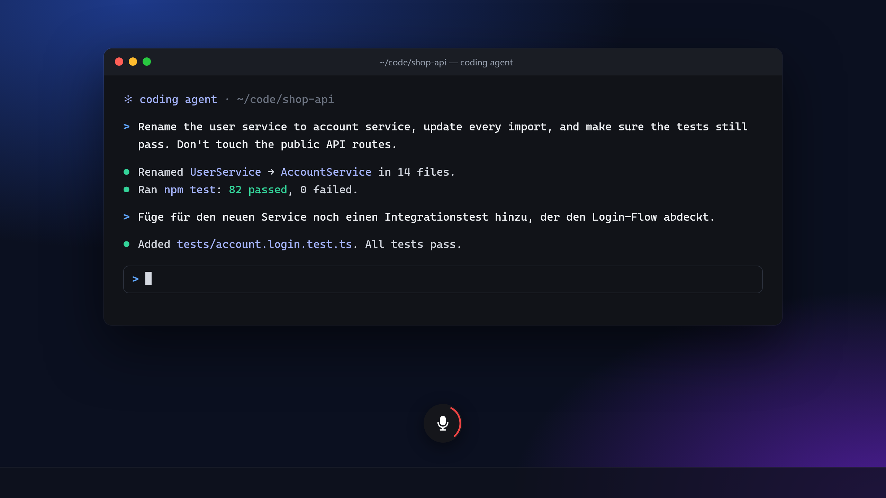

# Jabberwrite

**Talk to your coding agent instead of typing.** Press a shortcut, speak your prompt, press it again: the text is pasted into whatever window has focus.



- **Built for agentic workflows.** Long, detailed prompts are faster to say than to type. Works with any terminal, editor or chat box.
- **Dead simple.** One shortcut, a tray icon, a tiny badge while recording. No accounts, no cloud, no bells and whistles.
- **Multilingual.** 25 languages, no language setting needed. Switch languages from one prompt to the next.
- **Fast and private.** Runs fully offline on your machine after a one-time model download (~490 MB).
- **Windows, macOS and Linux.**

## Usage

1. Install the build for your platform from [Releases](https://github.com/marklechtermann/jabberwrite/releases).
2. Start Jabberwrite. It lives in the system tray. On first launch it downloads the speech model; the tray menu shows progress.
3. Press **Ctrl+Super** (Windows/Linux) or **Ctrl+Cmd** (macOS) and release it to start recording. Press and release again to stop. The transcript is copied to the clipboard and pasted.

Change the shortcut via tray → **Settings…**.

### Updating

Updates are checked only when you ask: tray → **Check for Updates…**, or **Settings… → Updates**. If a newer release exists, Jabberwrite offers to install it and restarts itself. Updates are signed; the app rejects anything not signed with the project key. Builds from before this feature (and the old `.msi`) must be updated by hand once, using the NSIS installer.

### Platform notes

- **macOS:** builds are unsigned. Right-click the app → Open on first launch. Grant Microphone, Input Monitoring and Accessibility permissions, then restart the app.
- **Windows:** builds are unsigned; SmartScreen may warn on first launch.
- **Linux, X11:** works out of the box.
- **Linux, Wayland (GNOME, KDE):** pasting goes through the desktop's Remote Desktop portal: on the first dictation the desktop asks once whether Jabberwrite may control the keyboard, and it may show a remote-control indicator while Jabberwrite runs. The global hotkey works out of the box through the desktop's Global Shortcuts portal: on first start the desktop asks once to confirm the shortcut. That shortcut needs a regular key, so the default Ctrl+Super is offered as **Ctrl+Super+Space**; change it in the dialog or later in the desktop's settings (not in Jabberwrite's). For this, Jabberwrite writes a hidden `~/.local/share/applications/io.github.marklechtermann.jabberwrite.desktop`. To keep modifier-only shortcuts like Ctrl+Super, add your user to the group `input` (`sudo usermod -aG input $USER`), log out and back in, and restart Jabberwrite; it then reads keyboard devices in `/dev/input` instead. Any member of `input` can read all keyboards; the app reads keystrokes only to match the shortcut and does not store or send them. With `/dev/input`, shortcut letters match the US key positions, so on other layouts they follow the physical key. Compositors without the portal (sway and other wlroots) need the group `input`. The recording badge needs `zwlr_layer_shell_v1` (KDE, sway and other wlroots compositors); GNOME shows no badge.

## Configuration

Settings are stored as JSON and can be edited by hand (restart to apply):

| OS      | Path                                                 |
| ------- | ---------------------------------------------------- |
| Linux   | `~/.config/jabberwrite/config.json`                  |
| Windows | `%APPDATA%\jabberwrite\config.json`                  |
| macOS   | `~/Library/Application Support/jabberwrite/config.json` |

```json
{
  "shortcut": "Ctrl+Super",
  "paste_shortcut": "Ctrl+V",
  "model_path": null,
  "clear_history_on_exit": false
}
```

- `shortcut`: modifiers (`Ctrl`, `Shift`, `Alt`, `Super`/`Cmd`) plus at most one key, e.g. `Ctrl+Alt+Space`. Modifier-only shortcuts fire on release.
- `paste_shortcut`: keystroke used to paste, e.g. `Ctrl+Shift+V` for Linux terminals.
- `clear_history_on_exit`: delete the recognition history when Jabberwrite quits (also in Settings).

Every recognized text is also appended to `history.jsonl` in the data directory (`~/.local/share/jabberwrite/` on Linux, `%LOCALAPPDATA%\jabberwrite\` on Windows, `~/Library/Application Support/jabberwrite/` on macOS), one JSON object per line. Settings lists the entries with a Copy button.
- `model_path`: directory with `encoder.int8.onnx`, `decoder.int8.onnx`, `joiner.int8.onnx` and `tokens.txt`, to use your own copy of the model.

## Development

Requirements: Rust (stable), Node.js (LTS), and on Linux:

```sh
sudo apt-get install libwebkit2gtk-4.1-dev libayatana-appindicator3-dev librsvg2-dev libasound2-dev libxdo-dev libdbus-1-dev
```

```sh
npm install
npm run tauri dev      # run the app
npm run tauri build    # build installers
cd src-tauri && cargo test
```

### Releasing

Release builds sign their updates (ADR 0005). One-time setup:

```sh
npm run tauri signer generate -- -w ~/.tauri/jabberwrite.key
gh secret set TAURI_SIGNING_PRIVATE_KEY < ~/.tauri/jabberwrite.key
gh secret set TAURI_SIGNING_PRIVATE_KEY_PASSWORD   # only if you set a password
```

Paste the printed public key into `plugins.updater.pubkey` in `src-tauri/tauri.conf.json`. Keep a backup of the private key: without it, installed apps can never update again.

Planning lives in [`docs/`](docs/) ([ideas](docs/ideas.md), specs, ADRs); see [AGENTS.md](AGENTS.md).

## Credits

- Speech recognition: [Orukeet](https://github.com/Oruk-AI/orukeet), a fine-tune of [NVIDIA Parakeet TDT 0.6B v3](https://huggingface.co/nvidia/parakeet-tdt-0.6b-v3). The model weights are licensed under [CC BY-SA 4.0](https://creativecommons.org/licenses/by-sa/4.0/) and downloaded at runtime; they are not part of this repository.
- Runtime: [sherpa-onnx](https://github.com/k2-fsa/sherpa-onnx) (Apache-2.0).
- All other open source components and their license texts are listed in [ACKNOWLEDGEMENTS.md](ACKNOWLEDGEMENTS.md) and in the app under Settings > Licenses. The file is generated with `npm run licenses` (see [AGENTS.md](AGENTS.md)).

## License

Copyright 2026 Mark Lechtermann. Licensed under [Apache-2.0](LICENSE).
